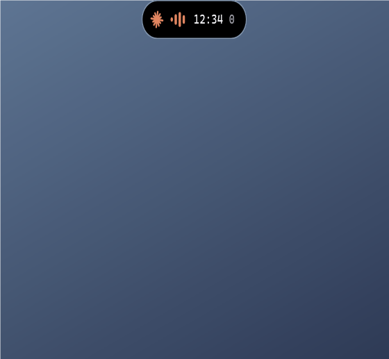

<h1 align="center">Track</h1>

<p align="center">
  <b>See what Claude Code, Codex and GitHub Copilot are doing — and what they cost — right from your Windows tray.</b>
</p>

<p align="center">
  <a href="https://github.com/katsSeges/track/releases/latest"></a>
  <a href="https://github.com/katsSeges/track/actions/workflows/ci.yml"></a>
  
  
</p>

<p align="center">
  
</p>

A small Windows tray app that shows whether Claude Code, Codex or GitHub Copilot is working right now,
and how many tokens (with an estimated price) each used today, this week and this month, with charts
per hour and per day. An optional black "island" at the top of the screen shows the running agent and a
live timer, and opens into the same usage view.

<p align="center">
  
</p>

Everything is read from the agents' own log files on your machine. Nothing is sent anywhere; the only
network request is a once-a-day download of the public LiteLLM price list.

**[Download the latest release](https://github.com/katsSeges/track/releases/latest)** — unzip, run
`scripts\install.ps1`, done. No .NET install needed.

<sub>Screenshots use made-up demo data.</sub>

## What you see

- **Tray icon**: the Claude, Codex and Copilot marks in a small triangle. A mark is in color while that
  agent is working and grey when idle. Tools you hardly use (below 5M tokens a week and 10M a month)
  are left out unless they are running. Hover for a tooltip.
- **Popover** (left-click the icon): what is running, then Today / Week / Month with the token count as
  the big number and `$price · in · out · cache` underneath, highest usage first. Hover a tool for its per-model breakdown.
  The week resets Monday 00:00, the month on the 1st, in your local time.
- **Usage chart** (in the popover, under the tabs): stacked bars per tool — per hour for Today, per day for
  Week and Month — with the scale's top value (`top 100.0M`) and a comparison line such as
  `+18 % vs last week at this time` (the previous period counted up to the same point). Hover a bar for its time,
  tokens, price and per-tool split; click it (or Left/Right + Enter) to see just that hour or day in the table,
  click again to go back. The small **−** button next to the top value minimizes the chart to its title line
  (**+** brings it back); the choice is remembered. The usage rows below never move.
- **Top island**: appears while an agent works (logo, waveform, timer since your last prompt, session
  tokens) and stays up as long as something runs. Click it for details; the **–** button there tucks it
  away while agents keep running (rest the mouse on the very top edge for 0.6 s to peek; click to open
  it again). When work ends it says "done" for 5 seconds (or "needs you" when Copilot stops to ask you something) and hides after 5 idle minutes; the top edge
  brings it back then too. Opened, it has two tabs: **Now** (the running agents) and **Usage** (the same
  Today / Week / Month chart, comparison and rows as the popover, in the island's dark look). The island
  remembers the tab you left it on.
- The tray icon, the popover and the island share one answer to "who is working": an agent counts as working
  from its prompt until its turn ends, and also while its log keeps being written after an end (for example
  when a Stop hook sends Claude back to work).
- **Right-click menu**: Refresh, icon layout, start with Windows, show top island, quit.

## What it reads

| Agent | Logs |
|---|---|
| Claude Code | `%USERPROFILE%\.claude\projects\**\*.jsonl` (and `.config\claude\projects`) |
| Codex | `%USERPROFILE%\.codex\sessions\**\rollout-*.jsonl` and `archived_sessions` |
| GitHub Copilot (app and CLI) | `%USERPROFILE%\.copilot\session-state\<session>\events.jsonl` |

Track keeps 90 days of totals in `%LOCALAPPDATA%\Track\snapshot.json`, so a restart only reads what was
written since. Settings live in `%LOCALAPPDATA%\Track\settings.json`.

## About the prices

Costs are **API-equivalent estimates** from LiteLLM's public list prices, not your bill: Claude, ChatGPT
and Copilot subscriptions are not charged per token. Models without a public price (e.g. Codex's
`codex-auto-review`) count their tokens but show `$—`, and totals that include them show `≈`. Long-prompt
surcharges and Claude's 1-hour cache-write rate are not applied, so estimates are slightly low
(on 18 Nov 2026: $56.19 vs ccusage's $59.53 for the same 143,598,000 Claude tokens).

## Install

**From a release (recommended):** download `Track-<version>-win-x64.zip` from the
[Releases page](https://github.com/katsSeges/track/releases), unzip it and run `scripts\install.ps1` in the
unzipped folder. The release build is self-contained, so no .NET installation is needed.

**From source:** needs the .NET 10 SDK; the installed build needs the .NET 10 Desktop Runtime.

```powershell
powershell -ExecutionPolicy Bypass -File scripts\install.ps1
```

This publishes Track, copies it to `%LOCALAPPDATA%\Programs\Track`, makes it start with Windows and
starts it. To remove it (keeps your data unless you add `-RemoveData`):

```powershell
powershell -ExecutionPolicy Bypass -File scripts\uninstall.ps1
```

## Build and test

```powershell
dotnet build Track.slnx -c Release
powershell -ExecutionPolicy Bypass -File scripts\test.ps1
```

`scripts\test.ps1` fails unless **Track.Core** has 100 % line, branch and method coverage. All logic lives
in Track.Core; the WPF shell (Track.App) only draws it. See `docs\coverage-exclusions.md`.

To check the chart numbers against your own logs, `scripts\check-series.ps1` compares Track's per-day and
per-hour totals with an independent count (`scripts\independent_usage.py`) and with `ccusage`, and prints
"All equal." when they match. It needs Python and Node (for `npx ccusage`).

## Releases

CI (`.github/workflows/ci.yml`) builds and runs the tests with the 100 % coverage gate on every push and pull
request. To release, set `<Version>` in `src/Track.App/Track.App.csproj`, add `docs/release-notes/v<version>.md`, and
push a matching tag (`git tag v1.0.0; git push origin v1.0.0`). `.github/workflows/release.yml` then builds,
tests, runs `scripts\package.ps1` (self-contained win-x64 zip + `.sha256`) and publishes the GitHub release.
`scripts\package.ps1` runs the same locally and writes to `artifacts\`.

## Project layout

```
src/Track.Core      parsing, ingest + snapshot, pricing, periods, visibility, live status,
                    activity (island), settings, view-models, tray icon layout
src/Track.App       WPF tray shell: tray icon, popover, model card, island, Windows glue
tests/              xUnit tests (coverage gate) and anonymized log fixtures
design/             the four clickable mockups the UI was decided with
plans/              the build plan with every phase's checks and results
```

## Verification switches

For checking the app without clicking around (used during development):

| Switch | Effect |
|---|---|
| `TRACK_HOME=<dir>` | read logs from another home folder |
| `TRACK_DATA=<dir>` | keep settings/snapshot/prices elsewhere |
| `TRACK_DIAG=1` | write the current state to `<data>\diag.txt` |
| `TRACK_POINTER_FILE=<file>` | drive the island with `x,y`, `click`, `minimize`, `fullscreen` lines, and the tabs/charts with `island:tab usage`, `island:period week`, `island:bar 17`, `popover:period month`, `popover:bar 29` |
| `TRACK_CLOCK_OFFSET=<seconds>` | with `TRACK_DIAG=1` only: run the app's clock this far ahead (or behind, negative) to watch midnight, week and month rollover |
| `--open`, `--card <tool>`, `--theme light\|dark` | open the popover (and card) at start |
| `--render-icons <dir>`, `--render-popover <dir>`, `--render-island <dir>` | save PNGs and exit |
| `--no-startup` | leave the "start with Windows" entry alone |

Logos are simplified stand-in marks; see `src/Track.App/Assets/logos/README.md` to use official ones.
