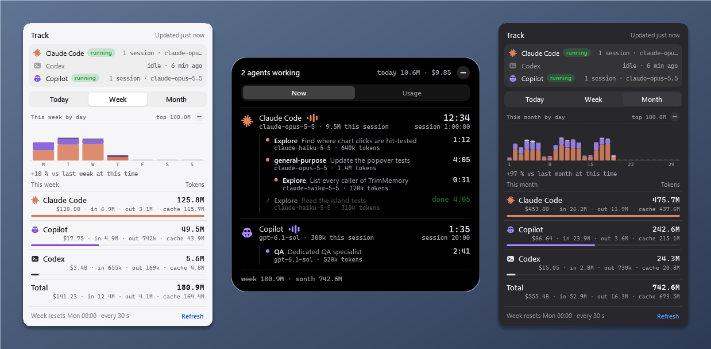
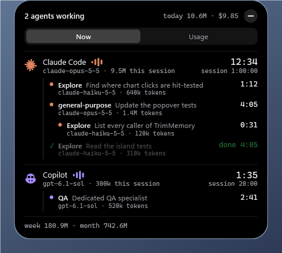

<h1 align="center">Track</h1>

<p align="center">
  <b>See what Claude Code, Codex, Copilot, Gemini CLI, OpenCode, Cline and Roo Code are doing, and what they cost, right from your Windows tray.</b>
</p>

<p align="center">
  <a href="https://github.com/katsSeges/track/releases/latest"></a>
  <a href="https://github.com/katsSeges/track/actions/workflows/ci.yml"></a>
  
  
</p>

<p align="center">
  
</p>

<p align="center">
  <a href="https://github.com/katsSeges/track/releases/latest"><b>Download for Windows</b></a> · no .NET install needed
</p>

## What it does

- **Who is working.** Provider marks in your tray light up while an agent works. Providers with recent usage or live activity appear automatically; you can also turn providers on or off in Settings.
- **What it costs.** Tokens and an estimated price for today, this week and this month, with adaptive charts for enabled providers.
- **Long tasks at a glance.** A small black island at the top of the screen shows each running agent, its timer, and the sub-agents it started.
- **Your way.** Follow the Windows theme or choose light/dark, select Acrylic, Mica, Mica Alt or Solid, and customize accent and provider colors with a hue/saturation wheel, brightness control and optional hex entry.
- **More detail.** Open Analytics for 7/30/90-day or custom ranges, model and session breakdowns, cache-hit rate, a busiest-hours heatmap and CSV export.

<table>
  <tr>
    <td align="center" width="50%"><br><sub>The island while agents work</sub></td>
    <td align="center" width="50%"><br><sub>Sub-agents under their agent</sub></td>
  </tr>
</table>

## Install

1. Download `Track-<version>-win-x64.zip` from [Releases](https://github.com/katsSeges/track/releases/latest) and unzip it.
2. In that folder, run:

   ```powershell
   powershell -ExecutionPolicy Bypass -File scripts\install.ps1
   ```

Track starts now and with Windows. To remove it, run `scripts\uninstall.ps1` the same way.

## Private by design

Track reads provider logs locally. It does not upload your usage. It downloads the public LiteLLM price list daily
for cost estimates. If you explicitly enable Ollama, Track checks its status only through the local
`127.0.0.1:11434/api/ps` endpoint; Ollama is status-only and has no token accounting.

| Agent | Logs |
|---|---|
| Claude Code | `%USERPROFILE%\.claude\projects` |
| Codex | `%USERPROFILE%\.codex\sessions` |
| GitHub Copilot | `%USERPROFILE%\.copilot\session-state` |
| Gemini CLI | `%USERPROFILE%\.gemini\tmp` |
| OpenCode | `%APPDATA%\opencode` (or `XDG_DATA_HOME` / `OPENCODE_DB`) |
| Cline | `%APPDATA%\Code\User\globalStorage\saoudrizwan.claude-dev\tasks` |
| Roo Code | `%APPDATA%\Code\User\globalStorage\RooVeterinaryInc.roo-cline\tasks` |
| Ollama | No logs; optional local running/loaded-model status only |

<details>
<summary><b>Tips</b></summary>

- Left-click the tray icon for the popover. Hover a tool to see its models.
- Click a provider row (or press Enter while it is focused) to open its detected chat app. Override the app per provider in Settings.
- Open Settings from the tray menu or the popover gear. The Behavior tab has a persistent notifications switch; notifications are off by default and this disables both agent and budget alerts.
- Set day/month spend or token budgets and a global popover hotkey in the Behavior tab.
- Click a bar in a chart to see just that hour or day; click it again to go back. The **−** next to the chart hides it.
- Open **Analytics…** from the tray menu or popover footer for the detailed range view and CSV export. Session totals are full-session totals when the observed session interval overlaps the selected range; the first-to-last span is observed span, not active time.
- Click the island to open it: **Now** lists the agents and sub-agents, **Usage** has the charts.
- The **–** button on the island tucks it away while agents keep working. Rest the mouse on the top edge to peek.
- When an agent finishes, the island says "done"; when Copilot asks you something, it says "needs you".

</details>

<details>
<summary><b>About the prices</b></summary>

Prices are API-equivalent estimates from LiteLLM's public list prices, not your bill: Claude, ChatGPT and
Copilot subscriptions are not charged per token. Models without a public price count their tokens but show `$—`.
Analytics is limited to 90 days. Session totals and observed spans cover the full session; they are not prorated to
the selected range, and older per-session history already pruned by Track 1.1 cannot be reconstructed.

</details>

## Development

Build, test, release and verification switches are in [docs/DEVELOPMENT.md](docs/DEVELOPMENT.md).

<sub>Screenshots use made-up demo data.</sub>
